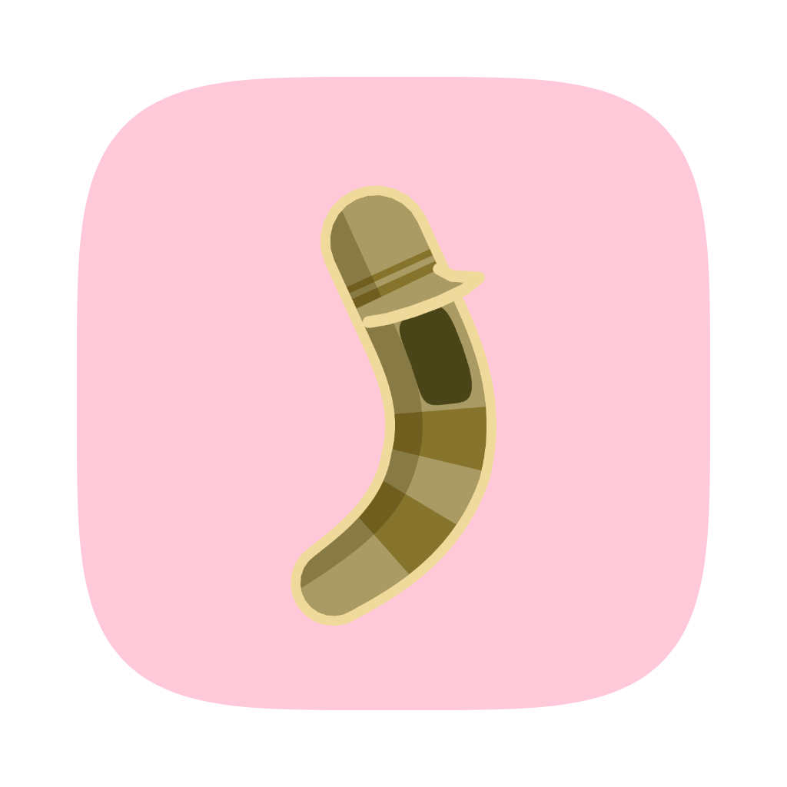
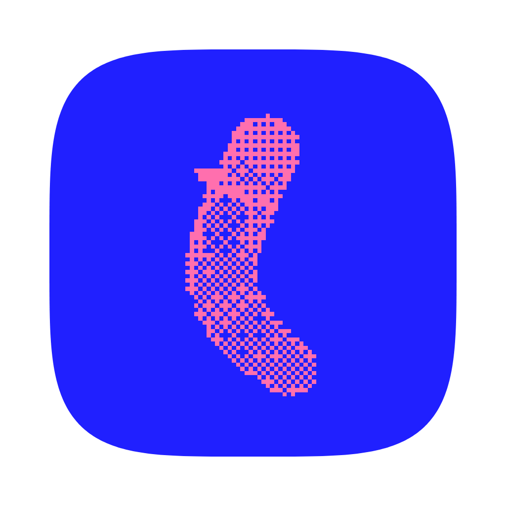
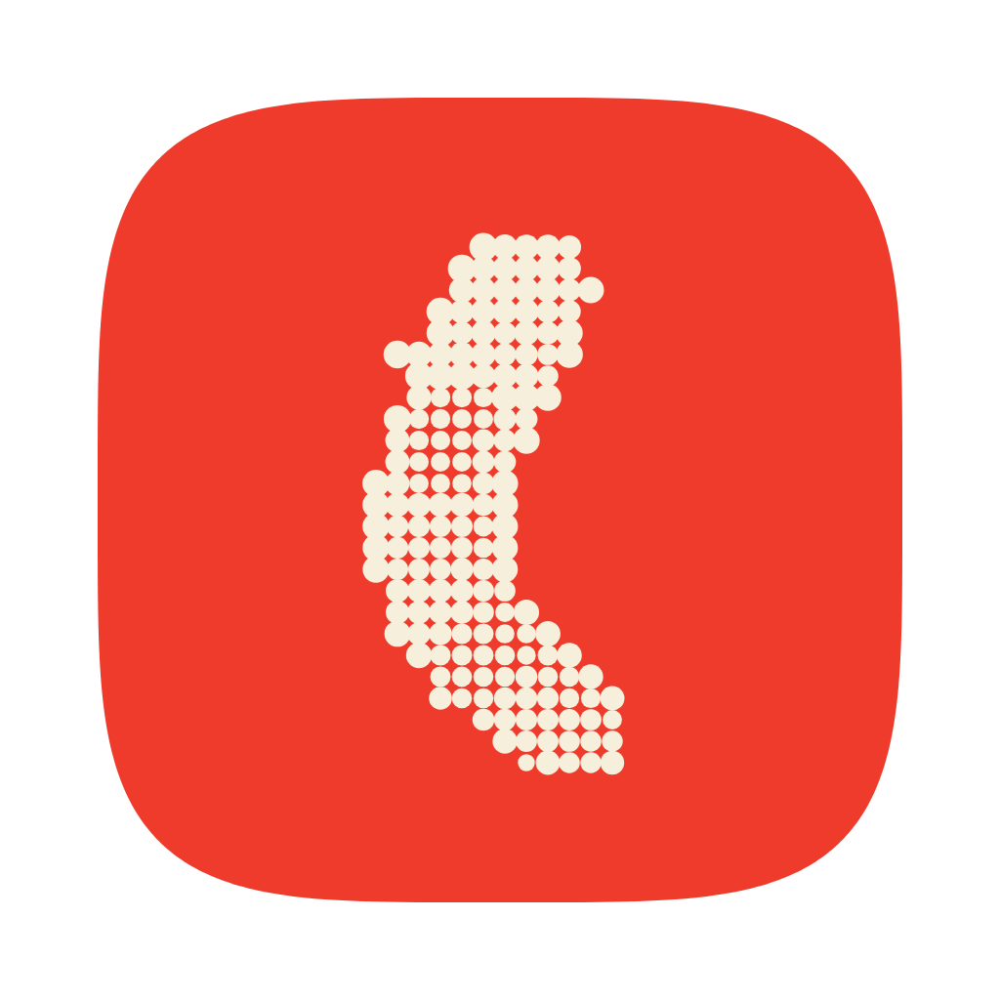
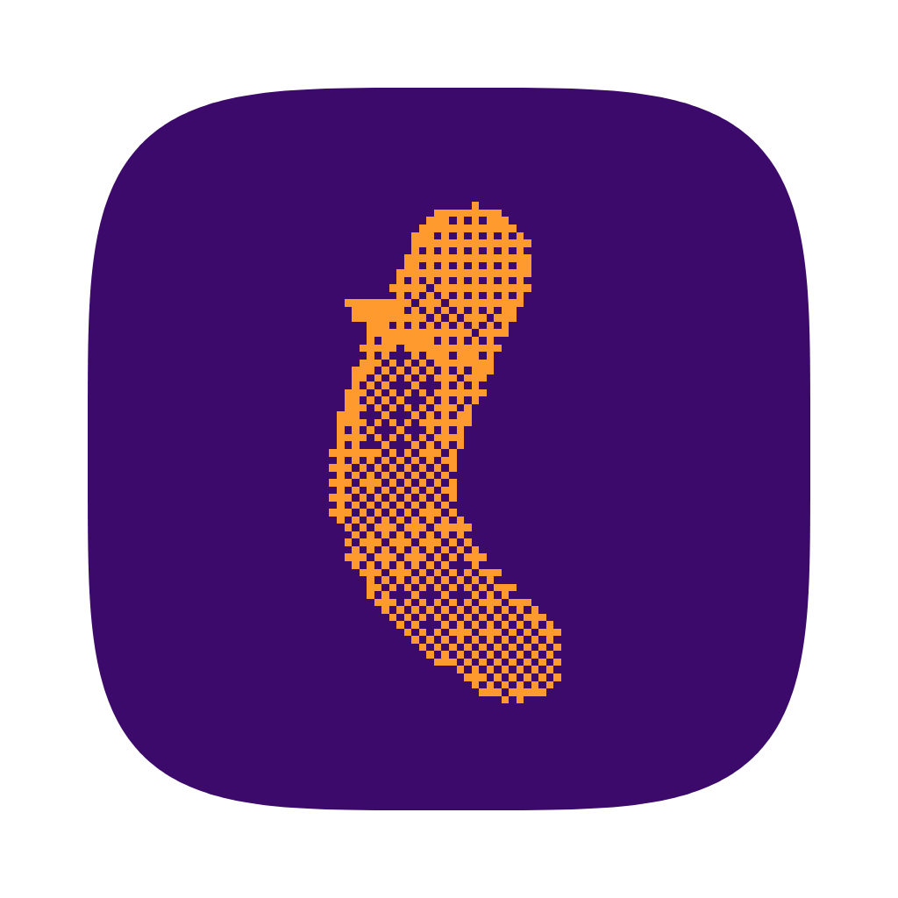

<p align="center">
  
</p>

<h1 align="center">Nematode</h1>

<p align="center">
  A little desktop buddy who walks over and stomps on your Claude tab.
  <br>
  <a href="https://github.com/Amaan630/nematode-desktop-app/releases/latest/download/Nematode-Mac.dmg"><b>Download for Mac</b></a>
  &nbsp;·&nbsp;
  <a href="https://github.com/Amaan630/nematode-desktop-app/releases/latest/download/Nematode-Windows-Setup.exe"><b>Download for Windows</b></a>
  &nbsp;·&nbsp;
  <a href="https://amaan630.github.io/nematode-desktop-app/">Website</a>
</p>

---

## What he does

- **Finds your Claude tab.** Switch to claude.ai in Chrome and he walks in from the left and stomps on that exact tab, whether your tabs run along the top or down the side.
- **Comes when called.** Choose **Summon Nematode** from the menu bar and he hangs out above your Dock, wandering around and sometimes running from your cursor. **Dismiss** sends him away.
- **Can be thrown.** Grab him and fling him around. He tumbles, bounces off the edges of your screen, picks himself up and walks back.
- **Has four looks.** Choose one under **App Icon** in the menu bar: Pink & Blue, Acid, Halftone or Purple.
- **Stays out of the way.** He lives in the menu bar, opens at login and updates himself.

<p align="center">
  
  
  
  
</p>

## Install

**Mac:** open `Nematode-Mac.dmg` and drag Nematode into Applications. The first time you open it, macOS warns that it's from an unidentified developer. Go to **System Settings → Privacy & Security** and click **Open Anyway**. Then click **Allow** so he can see where your tabs are.

**Windows:** run `Nematode-Windows-Setup.exe`.

Updates install themselves. Nematode checks when it opens and once a day.

## How it works

The app is built with [Tauri](https://tauri.app), so Mac and Windows share one codebase.

- `src/nematode.js` draws him as a striped tube along a bendable spine, which is how he can walk, squash, stomp and tumble.
- `src/index.html` is a transparent, click-through overlay across your screen. It only catches the mouse while your cursor is over him.
- `site/` is the website, published to GitHub Pages by `.github/workflows/pages.yml`.
- `src-tauri/` is the native app: the menu bar, open at login and updates. It also finds your tab: on Mac through Accessibility (`mac.rs`), on Windows through UI Automation (`win.rs`). Both read Chrome's address bar and the position of the selected tab.

## Develop

```bash
npm install
npm run dev         # run with live reload
npm run build:mac   # Nematode.app + .dmg, signed so Accessibility survives rebuilds
npm run icons       # re-render every icon from src/nematode.js
```

To preview the animation in a browser, serve `src/` and open `index.html?demo`.

## Release

Bump the version in `package.json`, `src-tauri/tauri.conf.json` and `src-tauri/Cargo.toml`, commit, then tag it:

```bash
git tag v0.3.0 && git push --tags
```

GitHub Actions builds the Mac and Windows versions and publishes a release with `latest.json`, which installed copies check for updates. Updates are signed with `~/.tauri/nematode.key`, which is also stored as the `TAURI_SIGNING_PRIVATE_KEY` repo secret. If that key is lost, installed copies can't update.
