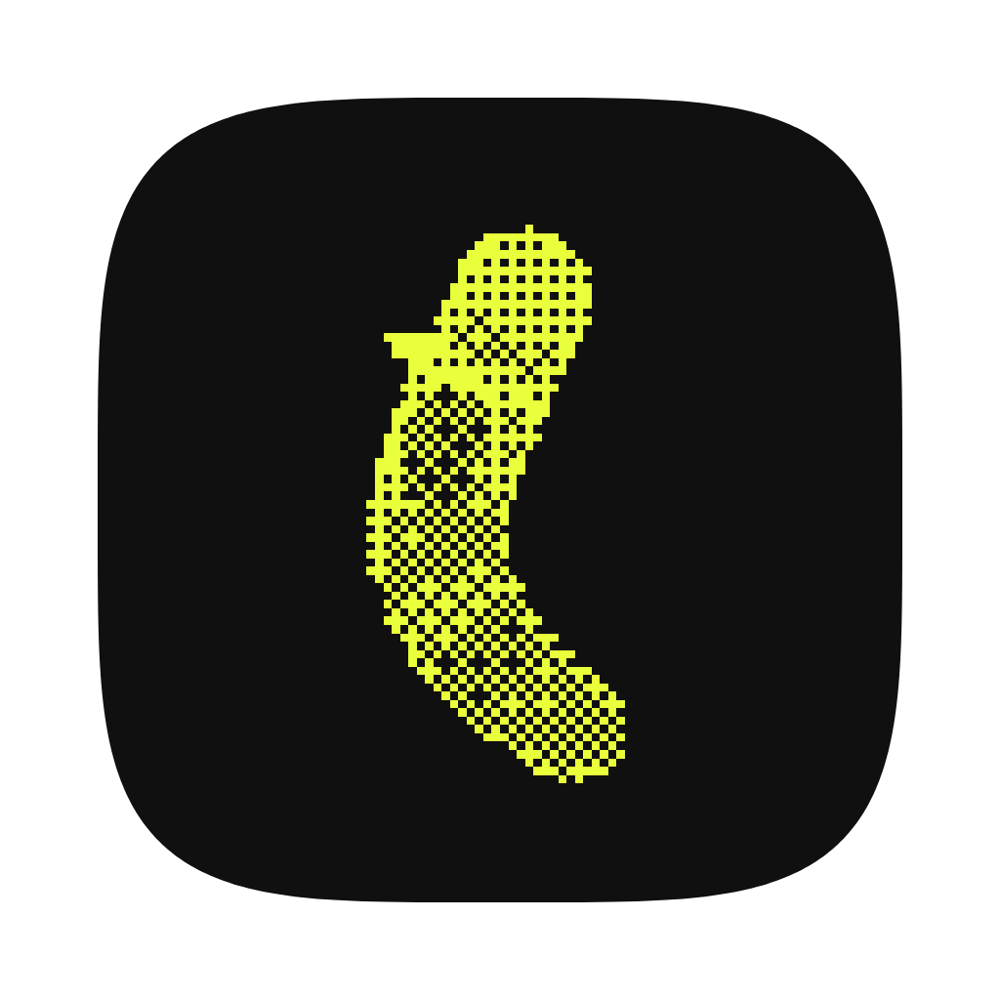

<p align="center">
  
</p>

<h1 align="center">Nematode</h1>

<p align="center">
  A little desktop buddy who walks over and stomps on your Claude tab.
  <br>
  <a href="https://github.com/Amaan630/nematode-desktop-app/releases/latest/download/Nematode-Mac.dmg"><b>Download for Mac</b></a>
  &nbsp;·&nbsp;
  <a href="https://github.com/Amaan630/nematode-desktop-app/releases/latest/download/Nematode-Windows-Setup.exe"><b>Download for Windows</b></a>
  &nbsp;·&nbsp;
  <a href="https://amaan630.github.io/nematode-desktop-app/">Website</a>
</p>

---

## What he does

- **Finds your Claude tab.** Switch to claude.ai in Chrome and he walks in from the left and stomps on that exact tab, whether your tabs run along the top or down the side.
- **Comes when called.** Choose **Summon** from the menu bar and he hangs out above your Dock, wandering around and sometimes running from your cursor. **Dismiss** sends him away.
- **Can be thrown.** Grab him and fling him around. He tumbles, bounces off the edges of your screen, picks himself up and walks back.
- **Two characters.** Nematode or Croissant, under **Character** in the menu bar. The menu bar icon follows your pick. Croissant waddles, and his ends jiggle when you fling him.
- **Four app icons.** Choose one under **App Icon**: Pink & Blue, Acid, Halftone or Purple.
- **Stays out of the way.** He lives in the menu bar, opens at login and updates himself.

<p align="center">
  
  
  
  
</p>

## Install

**Mac:** open `Nematode-Mac.dmg` and drag Nematode onto the Applications folder, following the arrow. The first time you open it, macOS warns that it's from an unidentified developer. Go to **System Settings → Privacy & Security** and click **Open Anyway**. Then click **Allow** so he can see where your tabs are.

**Windows:** run `Nematode-Windows-Setup.exe`. If SmartScreen appears, click **More info → Run anyway**.

Updates install themselves. Nematode checks when it opens and once a day. Full instructions are also on the [website](https://amaan630.github.io/nematode-desktop-app/#install).

## How it works

Built with [Tauri](https://tauri.app): one codebase for Mac and Windows. The characters and their movement are web code
(`src/`); the native side (`src-tauri/`) finds your tab, runs the menu and installs updates.

```
src/
  index.html            the overlay: a transparent, click-through window over your screen
  overlay.js            behavior: where he goes, walking, stomping, physics, grabbing, dust
  characters/*.js       one file per character: drawing + how it plays each moment
  setup.html            the one-time permission window
src-tauri/src/
  main.rs               startup wiring
  presence.rs           Away / On your tab / Summoned, and the overlay window
  locate.rs             finding the active claude.ai tab (via mac.rs / win.rs)
  menu.rs               the menu-bar / tray menu
  picker.rs             a remembered-choice submenu with previews (Character, App Icon)
  characters.rs icons.rs autostart.rs grab.rs screen.rs setup.rs store.rs update.rs
  docktile/             macOS Dock tile plugin, so the Dock follows the chosen icon
scripts/                build, icon and install-window rendering
site/                   the website, published by .github/workflows/pages.yml
```

`overlay.js` never draws anything itself. Each frame it describes the moment (walking, stomping, flying, how squashed,
how high) and hands that to the current character, which draws it its own way.

### Adding a character

1. Create `src/characters/<id>.js`: a drawing function, plus a `CHARACTERS.<id>` entry with `name`, `width`, `height`,
   `dust`, `gait` and `draw(ctx, at, motion)`. The contract is at the top of `src/overlay.js`; `croissant.js` is a
   short example.
2. Load it in `src/index.html`.
3. Run `npm run icons`. It finds every file in `src/characters/` and renders each one's menu preview and menu bar
   icon (trimmed to its outline) through its own `draw`.
4. Add one row to `src-tauri/src/characters.rs`.

App icons work the same way: one row in `src-tauri/src/icons.rs` and one entry in `scripts/icon.html` and
`scripts/icons.sh`.

## Develop

```bash
npm install
npm run dev         # run with live reload
npm run build:mac   # Nematode.app + .dmg, signed so Accessibility survives rebuilds
npm run icons       # re-render every icon and preview from src/characters/
```

To preview in a browser, serve `src/` and open `index.html?demo` (add `&char=croissant` for Croissant).

## Release

Bump the version in `package.json`, `src-tauri/tauri.conf.json` and `src-tauri/Cargo.toml`, commit, then tag it:

```bash
git tag v0.3.4 && git push --tags
```

GitHub Actions builds the Mac and Windows versions and publishes a release with `latest.json`, which installed copies check for updates. Updates are signed with `~/.tauri/nematode.key`, which is also stored as the `TAURI_SIGNING_PRIVATE_KEY` repo secret. If that key is lost, installed copies can't update.
